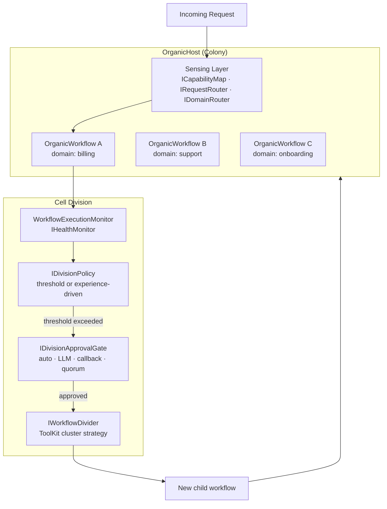

# Architecture: Organics

> Part of the [Architecture Guide](../ARCHITECTURE.md). Covers organic colony self-organization.

---

## Organic Colony Architecture

`Ananke.Organics` implements a **biological cell division metaphor** for self-organizing workflow ecosystems. Depends on `Ananke.Learning` + `Ananke.Design`.

### Key Types

| Type | Purpose |
|---|---|
| `OrganicHost` | Colony manager — hosts workflows, routes requests, triggers division |
| `OrganicWorkflow<TState>` | Workflow wrapper with complexity monitoring and domain affinity. Created via `OrganicWorkflowExtensions.JoinHost()` |
| `IWorkflowHost` / `InProcessWorkflowHost` | Host abstraction for cell lifecycle (spawn/kill). Production adapters implement Docker, K8s, etc. |
| `IWorkflowReplicator` / `WorkflowReplicator` | Clone a running cell for horizontal scaling (replication, not specialization) |

### Sensing

| Type | Purpose |
|---|---|
| `ICapabilityMap` / `InMemoryCapabilityMap` | Registry of what each workflow can handle |
| `IRequestRouter` / `KeywordRequestRouter` | Load-balance requests across replica cells serving the same domain |
| `IDomainRouter` | Post-division prompt classifier — routes across domains to the correct child cell |
| `IMeshAggregator` / `InMemoryMeshAggregator` | Aggregates per-cell `MetabolicSignal` reports into a mesh-wide `MeshSignal` |
| `RoutingAffinityTracker` | Adaptive routing table refinement after division events |
| `SensedCapability` | Capability descriptor with confidence score |
| `WorkflowSignal` | Heartbeat/load signal from a running workflow |

### Division

| Type | Purpose |
|---|---|
| `IDivisionPolicy` | Decide when to divide |
| `ThresholdDivisionPolicy` | Divide when complexity exceeds threshold |
| `ExperienceDrivenDivisionPolicy` | Use empirical memory to decide |
| `IHealthMonitor` / `WorkflowExecutionMonitor` | Track workflow load/complexity and health. Combines structural metrics (tool count, tag clusters) with execution telemetry (routing entropy, error rate) |
| `IWorkflowDivider` / `WorkflowDivider` | Execute cell division — derives child manifests, seeds children, spawns them, kills parent |
| `ToolKitClusterStrategy` | Cluster toolkit tools into child groups during division |
| `IDivisionApprovalGate` | Human/LLM/auto/quorum approval before division |
| `AutoApprovalGate` / `LlmApprovalGate` / `CallbackApprovalGate` / `QuorumApprovalGate` | Concrete gate implementations |
| `IDivisionOutcomeTracker` | Track division success for learning |
| `DomainAffinityMemory` | Remember which domains map to which workflows |
| `StructuralProfile` / `StructuralProfileFactory` | Analyze workflow structure for division |

### Snapshots

| Type | Purpose |
|---|---|
| `HostSnapshot` / `HostSnapshotExporter` | Serialize colony state |
| `WorkflowSnapshotBuilder` | Capture workflow topology + tools |
| `PromptWorkflowDesigner` | LLM-powered workflow design for new children |
| `WorkflowActivator<TState>` | Hydrate a `WorkflowSnapshot` into a runnable `Workflow<TState>` |
| `IWorkflowActivatorFactory` / `TypedWorkflowActivatorFactory` | Untyped factory used by `IWorkflowDivider` to spawn child cells without knowing `TState` |
| `ILineageStore` / `InMemoryLineageStore` | Track cell lineage (which cells were split from which parents) |

